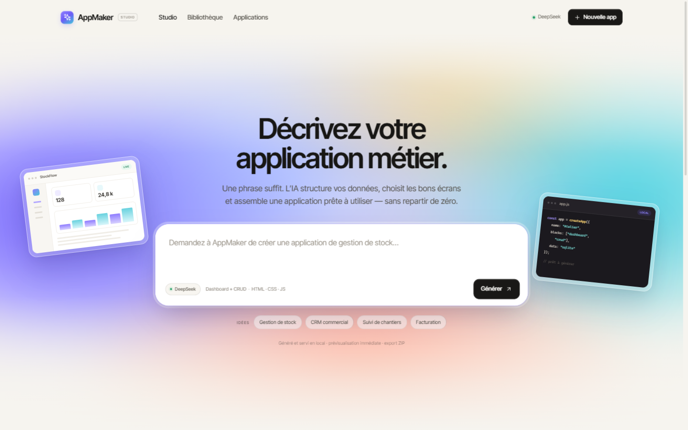
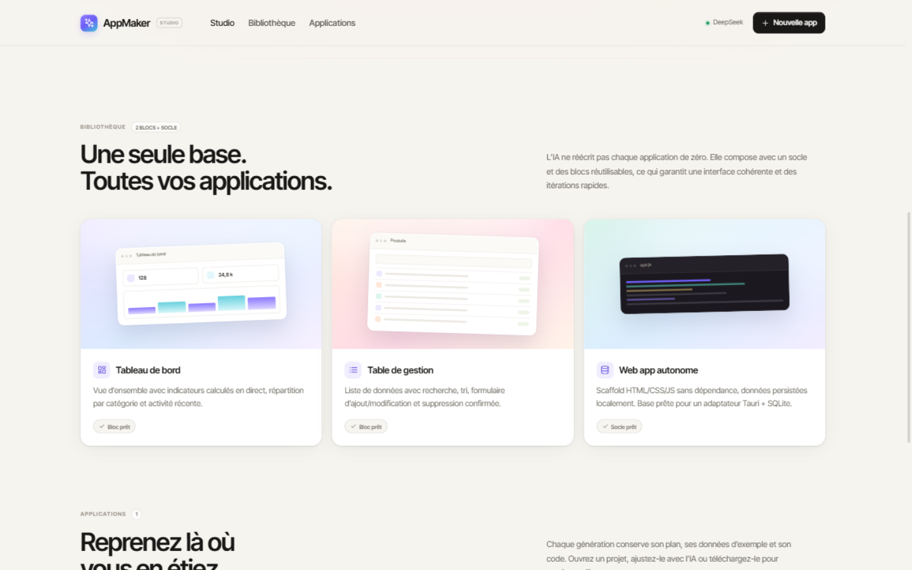
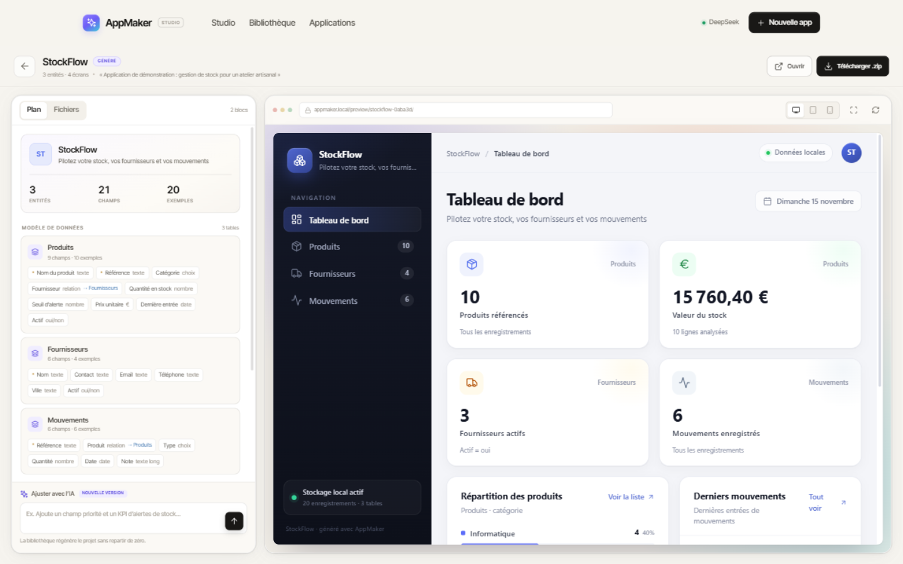
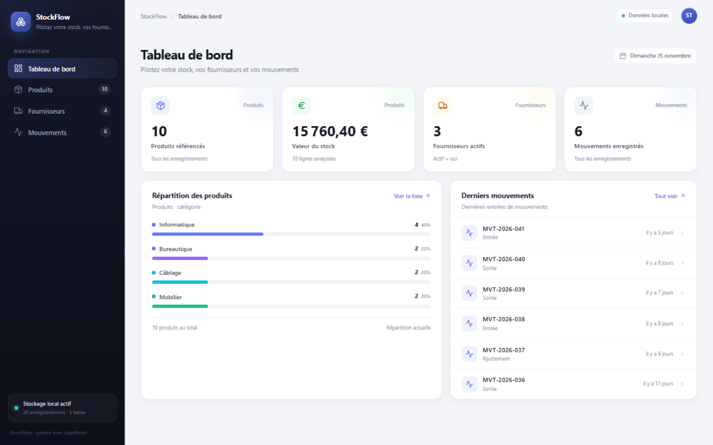
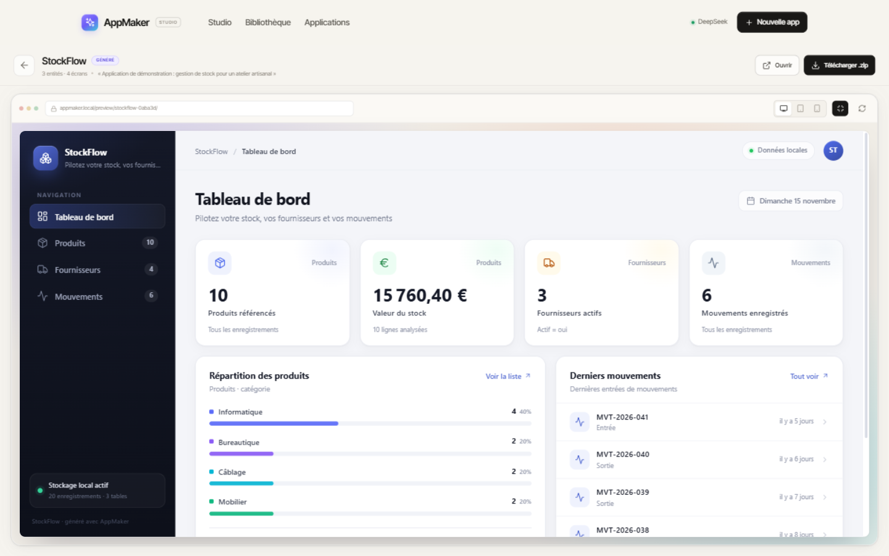
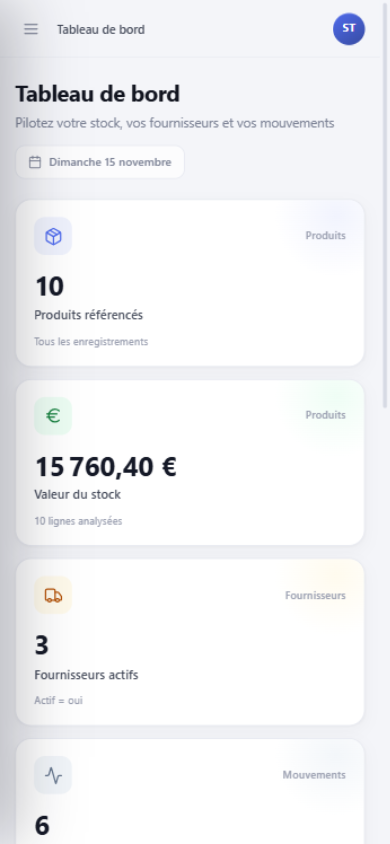
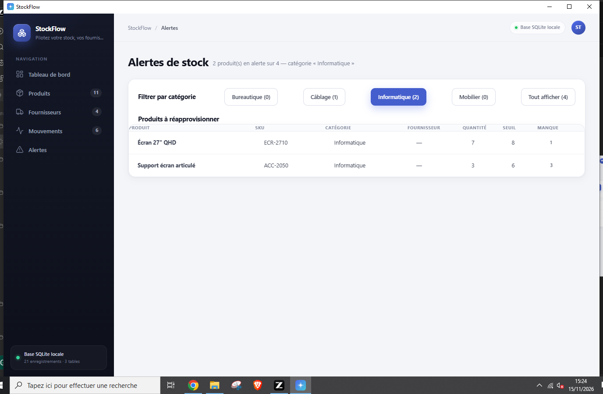
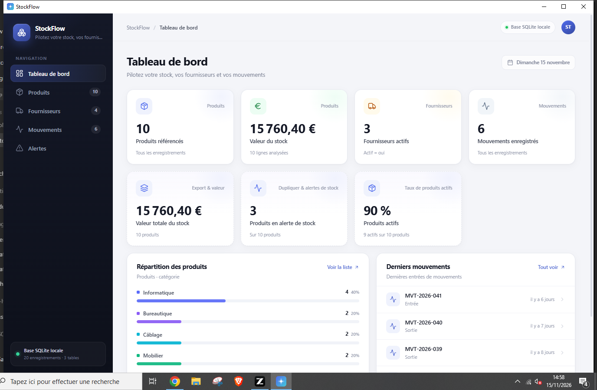

# AppMaker

> **Prototype** d’un studio IA qui transforme une phrase décrivant un besoin métier en application de gestion complète : HTML, CSS, JavaScript, données d’exemple, aperçu live, export ZIP et **installateur Windows (.exe) avec base SQLite locale**.

L’utilisateur écrit par exemple :

> « Je veux une application de gestion de stock : produits, fournisseurs, mouvements et alertes de stock bas. »

DeepSeek produit un **plan de données JSON**. AppMaker valide ce plan, choisit les blocs nécessaires dans sa bibliothèque et assemble le projet de façon déterministe. L’IA ne réécrit pas chaque écran de zéro.



| Bibliothèque de blocs | Résultat dans le studio |
| --- | --- |
|  |  |

| Application générée | Plein aperçu | Version mobile |
| --- | --- | --- |
|  |  |  |





---

## Démarrage

Prérequis : **Node.js 20+** (Node 22+ recommandé). Une seule dépendance : `playwright-core` (vérification navigateur de l’agent), installée par `npm install`. Le reste du studio n’utilise aucune librairie externe.

1. La clé DeepSeek est lue depuis le fichier `.env` à la racine :

   ```bash
   DEEPSEEK_API_KEY=sk-votre-cle
   DEEPSEEK_MODEL=deepseek-chat
   PORT=4173
   ```

   Le prototype fourni contient déjà un `.env` configuré. Pour repartir de zéro, copiez `.env.example` en `.env`.

2. Lancez le studio :

   ```bash
   npm start
   ```

3. Ouvrez [http://127.0.0.1:4173](http://127.0.0.1:4173).

Au premier démarrage, si aucune application n’existe, une **démo StockFlow** est générée automatiquement pour explorer le résultat sans appeler l’IA.

---

## Ce qui fonctionne dans ce prototype

- **Génération depuis un prompt** : DeepSeek renvoie un plan JSON via son mode JSON, validé et normalisé côté serveur.
- **Modélisation métier** : 3 entités en général, champs texte, nombre, montant, date, booléen, choix et **relations** entre entités, avec données d’exemple cohérentes.
- **Bibliothèque de blocs** :
  - `dashboard` : KPI calculés en direct (count / sum / avg, multiplicateur, filtres), répartition par catégorie, activité récente.
  - `crud` : recherche (insensible aux accents), filtre, tri, formulaire de création/édition, validation, suppression confirmée.
- **Assemblage déterministe** : scaffold HTML/CSS/JS + renderers et styles injectés depuis la bibliothèque.
- **Aperçu live** dans un iframe, avec formats bureau / tablette / mobile et **mode plein aperçu**.
- **Plan lisible** (entités, champs, relations, écrans, blocs) et **explorateur de fichiers** avec copie du code.
- **Itération IA** : « Ajoute un champ taux horaire et un KPI budget moyen » crée une nouvelle version complète, sans repartir du prompt initial.
- **Extensions** : actions de ligne et widgets de tableau de bord ajoutés sous `extensions/`, chargés par un registre généré — sans réécrire le socle.
- **Agent** : une instruction comme « ajoute un export CSV et un KPI d'alertes » est exécutée par un agent qui écrit l'extension, synchronise, vérifie et peut empaqueter.
- **Export ZIP** du projet : `index.html`, assets, `data/spec.json`, `data/schema.sql`, `README.md` du projet, metadata.
- **Export Windows** : le studio produit un **installateur NSIS** téléchargeable à partir d’un hôte Tauri précompilé, plus une version portable (ZIP) et les sources du build (`src-tauri/`).
- **Base SQLite locale** : migration du schéma et insertion des données d’exemple au premier lancement ; la base vit dans `%APPDATA%\com.appmaker.<app>\<app>.db`. En cas d’échec, repli automatique sur `localStorage` avec diagnostic copiable.
- **Empaquetage en quelques secondes** : un seul hôte Tauri est compilé par machine, puis chaque application n’est qu’un dossier de ressources + un script NSIS. Le cache partagé (`data/.build-cache/`) rend les builds prévisibles et supprime Rust du chemin par application.
- **Zéro dépendance** : serveur Node natif, aucune étape de build dans les applications générées.
- **Stockage local** : les données sont persistées dans `localStorage` (aperçu navigateur).
- **Mode démo hors IA** : `/api/demo` et l’action « Générer la démo StockFlow » permettent de tester sans clé API.

### Vérifications

```bash
npm run smoke
```

Le smoke test génère un projet complet, contrôle la syntaxe JavaScript, valide le schéma SQLite avec `node:sqlite`, teste les relations, l’archive ZIP, l’enveloppe Tauri générée (migrations, configuration, client SQL) et la neutralisation des clés dangereuses. Il ne fait aucun appel à l’IA et ne lance pas de compilation Rust.

---

## Export Windows (.exe)

Dans le studio, ouvrez une application puis cliquez sur **Installer sur Windows**. Le serveur enchaîne quatre étapes, affichées avec leur progression et leur journal :

1. **Préparation** : validation de l'outillage et du projet.
2. **Hôte précompilé** : l'hôte Tauri générique est réutilisé s'il existe, sinon il est compilé **une seule fois pour toute la machine**.
3. **Assemblage** : le binaire hôte, l'interface web, les icônes et les migrations SQLite sont copiés dans un dossier de ressources propre à l'application.
4. **Empaquetage** : NSIS produit l'installateur, et la même charge est archivée en version portable.

Aucune compilation Rust n'a lieu par application. Empaqueter une app revient à copier un binaire existant et à lancer NSIS : **3 à 6 secondes** sur une machine où l'hôte est déjà présent.

Les fichiers proposés au téléchargement sont : **Installer .exe**, **Version portable** (ZIP contenant l'exe et son dossier `resources/`) et **Sources du build** (projet `src-tauri/` complet pour les utilisateurs avancés).

### L'hôte générique

Le crate `src/host/` contient une seule application Tauri, compilée avec un identifiant fixe (`com.appmaker.host`). Au démarrage, elle :

- lit `resources/host.json` (nom, fichier de base, version, identifiant) ;
- sert l'interface depuis `resources/web/` via le protocole local `appmaker://` (rendu `http://appmaker.localhost` sous Windows), avec CSP stricte ;
- enregistre les migrations SQLite lues dans `resources/migrations/` pour `sqlite:<databaseFile>` ;
- ouvre la fenêtre avec le nom et l'icône de l'application.

Les bases de toutes les applications vivent dans `%APPDATA%\com.appmaker.host\<appId>.db` (l'identifiant Tauri est celui de l'hôte). L'installateur NSIS crée les raccourcis, l'entrée « Applications installées » et le désinstalleur, par utilisateur (aucun droit administrateur requis).

### Prérequis sur la machine de build

| Outil | Rôle | Vérification |
| --- | --- | --- |
| **Node.js 20+** | studio et empaquetage | requis |
| **NSIS** (`makensis`) | installateur | fourni par Tauri dans `%LOCALAPPDATA%\tauri\NSIS` |
| **Rust + Visual Studio Build Tools** | compilation de l'hôte, **une seule fois** | requis uniquement si `data/.build-cache/host/appmaker-host.exe` est absent |
| **WebView2** | moteur des applications | inclus sur Windows 11 ; l'installateur embarque le bootstrapper Microsoft pour les Windows 10 |

`GET /api/toolchain` expose ces vérifications : dès que l'hôte est en cache, Rust et MSVC sont marqués comme non requis.

### Durées et cache

- **Premier démarrage sur une machine** : compilation de l'hôte (dépendances Tauri comprises), de quelques minutes à ~35 min à froid. C'est un coût unique, pas un coût par application.
- **Ensuite** : chaque application est empaquetée en **3 à 6 secondes** ; la mise à jour de l'hôte ne se déclenche que si `src/host/` change.
- Le cache est dans `data/.build-cache/` : `host/` (hôte, bootstrapper WebView2), `packages/<appId>/` (payload et sorties), `target/` et `tooling/` (Rust/CLI si une recompilation est nécessaire).
- Variables optionnelles : `APPMaker_CACHE_DIR`, `APPMaker_TARGET_DIR`, `APPMaker_MAKENSIS`.
- Le nom de l'exe et du dossier d'installation suit le nom de l'application. Si une autre application du même nom est déjà ouverte, Windows peut verrouiller le fichier : le studio affiche alors une erreur explicite.

### Signature et SmartScreen

L'installateur n'est **pas signé** dans ce prototype. SmartScreen affiche donc un avertissement (« Éditeur inconnu ») au premier lancement. La signature de code reste indispensable avant une diffusion large : elle s'applique à l'hôte **une fois** et à chaque installateur produit. La mise à jour automatique signée (`tauri-plugin-updater`) n'est pas encore branchée.

---

## Extensions et agent

Le socle et les blocs ne sont pas figés : une application peut recevoir des **extensions** sans régénérer ni réécrire son code de base. Une extension est un module ES autonome, placé dans `extensions/<id>/index.js`, qui déclare des points d’accroche.

```js
export default {
  id: 'export-csv',
  name: 'Export CSV',
  hooks: {
    rowActions: [{
      id: 'produit-csv',
      entity: 'produit',
      label: 'Exporter en CSV',
      icon: 'download',
      run(ctx) {
        ctx.download('produits.csv', ctx.toCsv(ctx.rows, [
          { key: 'nom', label: 'Nom' },
          { key: 'quantite', label: 'Quantité' }
        ]), 'text/csv;charset=utf-8');
      }
    }],
    dashboardWidgets: [{
      id: 'valeur-stock',
      screen: 'dashboard',
      label: 'Valeur du stock',
      render(ctx) {
        const total = ctx.rowsFor('produit')
          .reduce((sum, row) => sum + row.quantite * row.prix, 0);
        return { value: ctx.formatMoney(total), label: 'Valeur totale', tone: 'mint' };
      }
    }]
  }
};
```

Points d’accroche disponibles aujourd’hui :

| Hook | Effet | Contexte |
| --- | --- | --- |
| `rowActions` | boutons ajoutés à chaque ligne d’un écran CRUD | `row`, `rows`, `entity`, `store.insert/update/remove`, `reload()`, `download()`, `toCsv()`, `ui.*` |
| `dashboardWidgets` | cartes indicateurs ajoutées à un tableau de bord | `rows`, `rowsFor(entityKey)`, `formatNumber`, `formatMoney`, `formatPercent` |
| `screens` | écran complet ajouté à la navigation et au routeur | `rows`, `rowsFor(entityKey)`, `store`, `reload()`, `icon()`, `escapeHtml`, formats |

Le registre est généré dans `assets/extensions.generated.js` : chaque module est importé statiquement, donc le mécanisme fonctionne à l’identique dans l’aperçu navigateur, dans l’application Windows et dans le binaire empaqueté.

### L’agent

L’agent n’est pas un générateur de fichiers : c’est un développeur qui travaille dans un bac à sable vivant, **exécute et prouve** ce qu’il fait.

1. il reçoit le modèle de données, les écrans, le contrat d’extension et la source des extensions existantes ;
2. il écrit du vrai code sous `extensions/` (`write_file`) ou ajoute une donnée (`add_field`) ;
3. le projet est **synchronisé immédiatement** (socle régénéré, extensions et migrations préservées, build invalidé) ;
4. `check_app` vérifie la syntaxe, charge réellement chaque module et teste les ressources HTTP ;
5. `verify_ui` **pilote l’aperçu réel dans un navigateur headless** : navigation, clics, saisie, rechargement, lecture du DOM et des erreurs console ;
6. il corrige et recommence (jusqu’à 30 étapes) jusqu’à ce que le comportement soit **observé**, puis résume ce qu’il a vérifié ; `build_windows` produit l’installateur si demandé.

Dans le studio, le panneau « Agent AppMaker » affiche le résumé et les fichiers modifiés. Côté API :

```text
POST /api/apps/:id/agent   { "instruction": "Rends l'écran Alertes filtrable par catégorie" }
→ { run: { summary, changedFiles }, transcript, app, spec, files }
```

#### Vérification navigateur

`verify_ui` s’appuie sur `playwright-core` et un **Edge ou Chrome déjà installé** (aucun téléchargement de navigateur). Sans ces éléments, le studio fonctionne et l’outil se déclare simplement indisponible (`GET /api/browser`).

| Action | Effet |
| --- | --- |
| `inspect` | état de la page : titres, navigation, boutons, champs, lignes, texte, erreurs console |
| `goto` | navigation par route (`#/alertes-stock`) |
| `click` | clic par libellé visible ou `aria-label` |
| `fill` | remplissage d’un champ (`name`, `id` ou libellé) |
| `reload` | rechargement complet de l’aperçu |
| `screenshot` | capture plein page dans `data/agent-shots/` |

#### Écrans interactifs

Un écran d’extension n’est plus une simple chaîne HTML : c’est un composant avec état et événements.

```js
let categorie = '';

export default {
  id: 'catalogue', name: 'Catalogue',
  hooks: { screens: [{
    id: 'catalogue', title: 'Catalogue', icon: 'list', entity: 'produit',
    render(ctx) {
      const lignes = ctx.rowsFor('produit').filter((r) => !categorie || r.categorie === categorie);
      return '<div class="page">…' + lignes.map(…) + '</div>';
    },
    on(name, el, ctx) {          // déclenché par data-ext-event="filtre"
      if (name === 'filtre') categorie = el.dataset.valeur;
      ctx.refresh();             // ne redessine que la zone de contenu
    },
    mount(root, ctx) { /* écouteurs fins si nécessaire */ }
  }] }
};
```

L’état vit dans une variable de module : un `ctx.refresh()` redessine uniquement le contenu et conserve l’état, sans recharger l’application.

Garde-fous :

- l’agent **ne modifie le code que sous `extensions/`** ; socle, blocs et `src-tauri/` sont en lecture seule, le schéma passe par `add_field` ;
- les modules sont validés (export par défaut, `id`, hooks connus, `run`/`render`/`mount`/`on` typés) avant d’être acceptés ;
- aucune dépendance externe, aucun `fetch`, aucune URL distante ;
- le bac à sable est le projet, pas la machine : les outils sont bornés au dossier de l’application ;
- le build est invalidé après chaque changement, donc l’installateur proposé correspond toujours à l’état affiché.

Limite actuelle : l’agent ajoute des champs (jamais de suppression ni de renommage), des actions, des widgets et des écrans interactifs. Les nouvelles entités et les imports CSV restent à construire.

---
---

## Architecture

```text
studio/ (interface) ── POST /api/generate ──> server.js
                                                   │
                                                   ├─ src/ai.js ──────> DeepSeek (JSON mode)
                                                   │      │ plan JSON
                                                   │      ▼
                                                   │  src/spec.js        validation + normalisation
                                                   │      │ spec
                                                   │      ▼
                                                          └─ src/generator.js
                                                          ├─ src/library/scaffolds/web/    HTML/CSS/JS + runtime
                                                          ├─ src/library/scaffolds/tauri/  Cargo, migrations, vendor SQL
                                                          ├─ src/library/blocks/dashboard/
                                                          └─ src/library/blocks/crud/
                                                                 │
                                                                 ├─ data/apps/<id>/files/  → aperçu /preview/<id>/
                                                                 ├─ ZIP + data/schema.sql
                                                                 └─ src/builder.js → hôte précompilé + payload → data/.build-cache → installateur NSIS
```

### Le choix central : un plan, pas du code libre

L’IA produit uniquement un **spec** (entités, champs, relations, écrans, KPI, données d’exemple). Le générateur traduit toujours ce spec avec les mêmes blocs.

Conséquences :

- le socle HTML/CSS/JS et le CRUD ne sont **jamais réécrits** à chaque génération ;
- les applications sont cohérentes visuellement et fonctionnellement ;
- une itération (refine) reste peu coûteuse en tokens et fiable ;
- les valeurs générées par l’IA sont contrôlées, échappées ou ignorées si invalides ;
- l’enveloppe desktop Tauri réutilise exactement le même spec, les mêmes blocs et le même code web.

### Bibliothèque de templates

```text
src/library/
├── blocks/
│   ├── dashboard/
│   │   ├── manifest.json    description du bloc, injectée dans le prompt IA
│   │   ├── renderer.js      code du renderer injecté dans assets/app.js
│   │   └── style.css        styles injectés dans assets/app.css
│   └── crud/
│       ├── manifest.json
│       ├── renderer.js
│       └── style.css
└── scaffolds/
    ├── web/
    │   ├── manifest.json
    │   └── files/
    │       ├── index.html.tpl
    │       ├── assets/app.css.tpl
    │       ├── assets/app.js.tpl   runtime : routes, formulaires, validation
    │       ├── assets/db.js.tpl    frontière SQLite / localStorage
    │       ├── assets/ui.js.tpl    icônes, formats, modales, toasts
    │       └── README.md.tpl       README livré avec chaque projet
    └── tauri/
        ├── manifest.json
        └── files/
            ├── Cargo.toml.tpl
            ├── build.rs
            ├── src/main.rs.tpl         plugin SQL + migrations embarquées
            ├── tauri.conf.json.tpl     fenêtre, CSP, bundle NSIS
            ├── capabilities/default.json
            └── vendor/                 modules ES du plugin SQL, épinglés
```

Pour **ajouter un bloc** :

1. créer `src/library/blocks/<id>/manifest.json` avec `id`, `name`, `description`, `whenToUse` et `renderer` ;
2. ajouter `renderer.js` (fonction de rendu du bloc) et `style.css` ;
3. autoriser le type d’écran correspondant dans `src/spec.js` et mentionner sa forme dans le prompt de `src/ai.js` ;
4. le bloc est automatiquement proposé à l’IA, puis injecté uniquement si un écran l’utilise.

Pour **ajouter un scaffold** (Electron, autre moteur desktop…), il suffit d’ajouter un dossier sous `src/library/scaffolds/` avec son `manifest.json` et ses fichiers `.tpl`, puis de le brancher dans la génération. Deux scaffolds existent : `web` (aperçu navigateur) et `tauri` (application Windows + SQLite).

Les futurs **recipes métier** (blueprints stock, CRM, facturation) pourront pré-remplir ou guider le spec pour les domaines fréquents. Aujourd’hui, le spec de démo StockFlow joue ce rôle d’exemple.

---

## Application générée

Chaque projet exporté est autonome :

```text
.
├── index.html
├── favicon.svg
├── assets/
│   ├── app.css         design system + styles des blocs
│   ├── app.js          navigation, rendu, formulaires, validation
│   ├── extensions.js    registre et contrat d'extension
│   ├── extensions.generated.js  imports des extensions du projet
│   ├── db.js           DataStore local (localStorage)
│   └── ui.js           icônes, formats, modales, toasts
├── data/
│   ├── spec.json       plan de données source
│   └── schema.sql      schéma SQLite (documentation, relations en commentaire)
├── extensions/         modules ajoutés par l'agent (actions, widgets)
├── src-tauri/          enveloppe de bureau + base SQLite
│   ├── Cargo.toml
│   ├── tauri.conf.json
│   ├── src/main.rs     plugin SQL, migrations embarquées
│   ├── migrations/     0001_init.sql (schéma), 0002_seed.sql (données)
│   ├── capabilities/   permissions IPC du plugin SQL
│   ├── icons/          icônes générées (PNG + ICO)
│   └── web/            interface embarquée dans le binaire
│       └── vendor/     client SQL minimal (modules ES épinglés)
├── appmaker.json       traçabilité de génération
└── README.md           guide du projet généré
```

Pour l’exécuter hors du studio :

```bash
npx serve .
# ou
python -m http.server 8080
```

Dans un navigateur, les données sont stockées sous la clé `appmaker.v1.<appId>` ; supprimer cette clé réinitialise l’exemple. Dans l’application Windows, elles vivent dans `%APPDATA%\com.appmaker.<app>\<app>.db` (SQLite), créées par les migrations au premier lancement.

### Tauri + SQLite : fonctionnement

- **Une seule base de code UI** : `src-tauri/web/` contient exactement les fichiers de l’aperçu. Le scaffold les embarque via `include_dir!` dans le binaire.
- **Client SQL minimal** : `src-tauri/web/vendor/sql.js` appelle directement l’IPC Tauri 2 (`plugin:sql|load/select/execute`), car les plugins ne sont plus injectés automatiquement dans `window.__TAURI__` depuis Tauri 2.6.
- **Migrations** : `main.rs` enregistre `0001_init.sql` et `0002_seed.sql` pour `sqlite:<appId>.db`. La base et les données de démonstration sont créées au premier démarrage.
- **Permissions** : `capabilities/default.json` accorde `sql:default` et `sql:allow-execute` (nécessaire pour INSERT/UPDATE/DELETE).
- **Repli** : si SQLite est indisponible, `assets/db.js` bascule sur `localStorage`, l’interface indique le mode actif et propose de copier un diagnostic.
- **Sécurité** : CSP stricte (`'self'` uniquement), aucun CDN, identifiants de tables/colonnes validés avant interpolation SQL.

---

## API locale

| Méthode | Endpoint | Rôle |
| --- | --- | --- |
| `GET` | `/api/health` | État du studio, du modèle et de la bibliothèque |
| `GET` | `/api/library` | Blocs, scaffolds et recipes disponibles |
| `GET` | `/api/apps` | Applications récentes |
| `GET` | `/api/apps/:id` | Manifest, spec et fichiers d’une application |
| `POST` | `/api/generate` | `{ prompt }` → nouveau projet |
| `POST` | `/api/demo` | Génère la démo locale sans IA |
| `POST` | `/api/apps/:id/refine` | `{ instruction }` → nouvelle version |
| `POST` | `/api/apps/:id/agent` | `{ instruction }` → exécution de l’agent (extensions + vérification) |
| `GET` | `/api/apps/:id/download` | Archive ZIP du projet |
| `GET` | `/api/toolchain` | Disponibilité de Rust, MSVC, cible MSVC, Node |
| `POST` | `/api/apps/:id/build` | Lance (ou relaie) le build Windows ; renvoie l’état |
| `GET` | `/api/apps/:id/build` | Progression, étapes, journal, artefacts |
| `GET` | `/api/apps/:id/download-exe` | Installateur NSIS (`?kind=exe` pour l’exécutable) |
| `GET` | `/api/apps/:id/bundle` | ZIP des sources `src-tauri/` du build |

Les réponses d’erreur sont au format `{ error: { message, code } }`.

---

## Sécurité et garde-fous

- La clé API reste **côté serveur**, dans `.env` (ignoré par Git). Elle n’est jamais envoyée au navigateur.
- Le serveur écoute par défaut sur `127.0.0.1` uniquement.
- Le mode JSON de DeepSeek, la normalisation du spec et des limites de taille réduisent les sorties invalides.
- Les textes de l’IA sont échappés avant insertion dans l’application générée ; les icônes et couleurs sont validées.
- Les applications générées sont servies avec une politique CSP et sans dépendance externe au chargement.
- Aucune authentification : ce prototype est un outil local, à ne pas exposer tel quel sur un réseau public.

---

## Limites connues

- Deux blocs seulement (`dashboard`, `crud`) ; pas encore de kanban, calendrier, import CSV, rôles ou permissions.
- Jusqu’à 3 entités en pratique (4 maximum après normalisation) et 9 champs par entité.
- Données SQLite locales adaptées à de petits volumes ; pas de pagination ni de synchronisation multi-postes.
- L’IA peut varier ; le serveur normalise et complète le plan, mais il ne corrige pas le fond métier.
- L’agent ne modifie le code que sous `extensions/` ; le schéma passe uniquement par `add_field` (ajout de champ, pas de suppression ni de renommage).
- Les hooks disponibles sont `rowActions`, `dashboardWidgets` et `screens` ; les écrans personnalisés utilisent les styles existants.
- Le refine (plan) crée toujours une nouvelle application (nouvel identifiant et nouvelles données d’exemple).
- Le premier empaquetage sur une machine exige Rust + MSVC pour compiler l’hôte (plusieurs minutes) ; les suivants n’en ont plus besoin.
- L’installateur n’est pas signé : SmartScreen avertit au premier lancement. Pas encore de mise à jour automatique.
- L’icône affichée dans l’Explorateur pour l’exe est celle de l’hôte ; le raccourci et l’installateur portent, eux, l’icône de l’application.
- Toutes les applications partagent le dossier de données `%APPDATA%\com.appmaker.host` (une base distincte par application).
- La vérification navigateur exige `playwright-core` et un Edge ou Chrome installé ; elle n’est pas couverte par le smoke test.
- Le smoke test ne couvre ni les appels DeepSeek, ni la compilation Tauri réelle.

---

## Pistes suivantes

1. **Signature et mises à jour** : certificat de signature de code, `tauri-plugin-updater` avec clé dédiée, canal de version par application.
2. **Bibliothèque plus riche** : kanban, planning, import CSV, graphiques, blocs de formulaire avancés.
3. **Recipes métier** : blueprints stock/CRM/facturation pour guider le spec et améliorer la qualité.
4. **Édition du spec** : modifier les champs/écrans dans le studio sans repasser par l’IA, comparer les versions.
5. **Schéma avancé** : nouvelles entités, renommage/suppression de champs avec migration de données, relations ajoutées après coup.
6. **Gouvernance** : authentification, rôles, audit, sauvegarde/restauration, tests E2E.

---

## Structure du dépôt

```text
AppMaker/
├── server.js              serveur HTTP sans dépendance + API
├── src/
│   ├── ai.js              prompt, appel DeepSeek, parsing JSON, refine
│   ├── spec.js            validation/normalisation du plan + spec de démo
│   ├── generator.js       assemblage projet web + enveloppe Tauri, SQLite, blocs
│   ├── builder.js         outillage, hôte précompilé, payload, NSIS, artefacts
│   ├── agent.js           boucle agent, outils bornés, vérification du projet
│   ├── icons.js           icônes PNG/ICO sans dépendance
│   ├── zip.js             export ZIP natif
│   ├── config.js          chargement de .env
│   ├── host/              hôte Tauri générique + template installateur NSIS
│   └── library/           bibliothèque de blocs et scaffolds (web, tauri)
├── studio/                interface du studio (HTML/CSS/JS, police locale)
├── scripts/smoke.js       smoke test hors IA (web + enveloppe Tauri)
├── docs/                  captures du prototype
└── data/
    ├── apps/              applications générées à l’exécution (ignoré par Git)
    └── .build-cache/      hôte, payloads, NSIS, dépendances Rust partagés (ignoré par Git)
```

---

*Prototype AppMaker v0.1 — construit pour itérer vite, avec une architecture de blocs réutilisables. Typographie Inter Tight (SIL OFL 1.1), embarquée dans `studio/fonts/`.*
